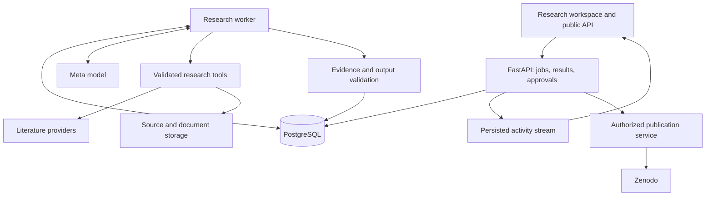

# Polymath: Architecture

Status: implementation baseline agreed in the project conversation, 27 October 2026. The application foundation is implemented; live research is not enabled. See [SPEC.md](SPEC.md) for product requirements, [BUILD_PLAN.md](BUILD_PLAN.md) for tasks, [PROGRESS.md](PROGRESS.md) for verified progress, and [DEVELOPMENT.md](DEVELOPMENT.md) for setup.

## 1. Goal and decisions

Build the complete research product for the hackathon: Explore, Ask, Surprise Me, live research, connections between connections, a growing knowledge base, a map, Formalise, Write, approval-gated Publish, and a public API. Sequence implementation around a shared engine; do not silently defer these capabilities or substitute simulated research for working features.

Meta intelligence drives research decisions. Muse Spark is the preferred model; another capable Meta model is an alternative if availability requires it. Verify actual access and capabilities before selecting an exact model. Development assistance from Codex is separate from the intelligence shipped inside Polymath. Never silently substitute a non-Meta model.

| Area | Decision | Reason |
|---|---|---|
| Web interface | React, TypeScript, Vite | Interactive research workspace with one API shared by all features |
| Application API | Python, FastAPI, Pydantic | Typed research tools, source processing, model integration, streaming |
| Database | PostgreSQL, SQLAlchemy, Alembic | Durable investigations, concurrent jobs, evidence relationships, migrations |
| Research execution | Worker process and PostgreSQL-backed job queue | Investigations survive browser disconnects; no Redis prerequisite initially |
| Activity delivery | Persisted events and server-sent events (SSE) | Live updates with replay after reconnecting |
| Documents | Storage interface: local volume in development, persistent volume or object storage in deployment | Preserve retrieved source versions and generated documents |
| Deployment | Container image with API/web and worker entry points; managed PostgreSQL | Simple release process with persistent state and independently restartable processes |
| Search | Provider adapters; begin with OpenAlex metadata and arXiv/open-access text | Source diversity without building a literature crawler first |

Serve the built frontend from the API in production. Use Vite's development server with an API proxy locally. Start with one worker and bounded research concurrency; expand only after budget and job ownership controls pass tests. Select a host after checking background workers, persistent storage, SSE behavior, and cost. Hosting costs are separate from the $150 model credits.

## 2. System boundaries

Publication is a separate permission boundary. The research model cannot authorize a deposit. Source documents and model output are untrusted input; they do not grant tools new permissions.

## 3. Adaptive research controller

Each investigation maintains its goal, hypotheses, research frontier, evidence, objections, unresolved questions, remaining budget, and stopping conditions. The model chooses a next action, receives a tool observation, and revises its investigation. It can branch, search again, seek counterevidence, change fields, reject a bridge, or stop with no strong result.

Initial tools:

- Search literature and resolve a paper's identity.
- Retrieve accessible source text and inspect passages.
- Search existing papers, bridges, and previous investigations.
- Record a hypothesis, structural mapping, objection, or supporting passage.
- Request a bounded mathematical check through an allowlisted tool.
- Propose a finding or conclude that the evidence is insufficient.

Application code validates tool arguments, evidence references, permissions, budgets, and output schemas. The model decides the research direction within those constraints. Begin with a small explicit controller rather than a large agent framework.

Use native tool calling if verified. If the selected Meta model lacks native tools or strict JSON schemas, test a validated action-envelope protocol with bounded correction attempts. Do not assume OpenAI compatibility implies feature parity. Unsupported capabilities must have a tested alternative or remain a reported blocker.

Store model, prompt/schema version, tool inputs and outcomes, source identifiers, usage, and run configuration. Store useful research state and concise decision summaries. The public activity stream reports actual actions and findings; it does not expose hidden model reasoning or manufacture activity. Ongoing source changes and nondeterministic model output mean a replay is an audit trail, not a promise of identical answers.

## 4. Evidence and scientific claims

The evidence store links a claim to a retrieved passage, a specific source version, and its location. Preserve paper identifiers, title, authors, publication information, retrieval URL/time, content hash, extraction method, and accessible text boundaries. Distinguish full text, abstract, and metadata. Never imply full-text support when only an abstract was retrieved.

Before a bridge is published as a supported finding:

1. Resolve real source identities on both sides.
2. Match quoted passages to retrieved text using a documented normalization rule; preserve the original text.
3. Explain the mapping, its assumptions, and the question it might help answer.
4. Search for prior connections and serious objections or counterexamples.
5. Record which objections survive, which assumptions remain, and where evidence is missing.

Exact quotation checks establish quotation integrity, not scientific truth. Evaluate whether sources actually support the claims, including human review of representative findings. Model-generated criticism is scrutiny, not independent scientific verification.

Keep evidence strength, mapping validity, and novelty assessments separate. Confidence must include a rationale and limitations; do not present uncalibrated scores as probabilities. Novelty means what was or was not found within recorded searches, never proof that nobody has made the connection. Label inferences and speculation explicitly. Corrections create new finding versions and preserve earlier provenance.

## 5. Shared data model

| Entity | Essential contents |
|---|---|
| ResearchRun / Job | Mode, goal, state, owner/session, lease, checkpoint, limits, cancellation |
| ResearchEvent | Run, ordered sequence, type, public summary, referenced artifacts |
| Paper / SourceVersion | Canonical identity, metadata, accessible content, retrieval details, hash |
| Passage / Claim / EvidenceLink | Text location, claim status, supports/contradicts relationship |
| Hypothesis / BridgeVersion | Fields, mapping, source links, objections, outcome, novelty search, evidence assessment |
| KnowledgeLink | Paper/field/bridge relationships, including bridges between bridges |
| Conjecture / CheckResult | Definitions, assumptions, statement, attempted checks, result and verifier |
| DocumentVersion | Summary/paper content, citations, source finding versions, content hash |
| Publication / Approval | Exact document version, metadata, authorized approver, environment, deposit/DOI state |
| Usage / BudgetReservation | Provider/model, request status, token usage, cost estimate/actual, reservation |
| Watch / IngestionJob | Topic/query, schedule, cursor, new sources, affected findings |

Use relational tables and explicit relationships initially; neither a graph database nor a vector database is required to represent the knowledge graph. Start retrieval with identifiers, filters, and PostgreSQL full-text search. Evaluate embeddings only if retrieval quality requires them and an appropriate model is available.

## 6. Product modes

- **Explore:** seed the controller with a concept; return supported bridges, rejected candidates, and unresolved questions.
- **Ask:** investigate a question and compose an answer whose claims link to evidence and are marked Known, Postulated, or Speculative. These are evidence classifications, not guarantees of truth.
- **Surprise Me:** the model chooses fields using distance, coverage, unresolved questions, and previous results; investigates them; and may climb to connections between connections. Display actual field choices and research outcomes, including empty results.
- **Connections between connections:** investigate shared structures across bridge versions. Higher-level claims must trace through the underlying evidence and cannot gain confidence merely by combining uncertain premises.
- **Growing knowledge base:** preserve completed research. Scheduled, bounded ingestion finds new literature, deduplicates it, and schedules reassessment of relevant findings. Retain superseded versions and show when a finding changes. The local collection slice uses browser-owned watches, a separate no-model worker, frozen per-provider time windows/cursors, immutable page observations, and exact per-watch seen-version links. It shares fenced jobs/queue limits while remaining disabled separately from paid research. Page/cursor commits are atomic, failures retain their own continuation, and session expiry/pause fences collection. Bibliographic aliases are preserved without rewriting old versions. Collected abstracts enter the map as unassessed sources; collection does not imply relevance, an assessment or a new discovery. Meta-led reassessment must use the existing budget/dispatch boundary, pin exact old/new evidence, and preserve unsupported/superseded history; that workflow is implemented locally with explicit synthetic model/source verification. Exact retrieval handles preserve old/new versions of a paper, and unchanged/revised/unsupported outcomes apply through a head revision comparison in the same transaction as the final assessment/job status. Inconclusive or concurrent losing attempts retain audit only. New memory, parent selection, writing and publication use current supported findings; explicit historical bytes and verified publication facts remain inspectable. See [REASSESSMENT.md](REASSESSMENT.md).
- **Map:** browse fields, papers, bridges, and higher-level links; each connection opens its evidence. Use bounded graph queries and progressive loading.
- **Formalise:** extract assumptions and definitions, state a conjecture, and attempt derivations or counterexample searches. Numerical checks and proof sketches stay labelled as such. Only label a result formally proved when an appropriate verifier actually accepts it; otherwise retain its open status.
- **Write:** generate a plain summary or formal paper from versioned findings. Validate references and flag unsupported additions before preview/export.
- **Publish:** prepare and preview an exact document and metadata; require an authorized human approval bound to their hashes; then create/upload/publish through Zenodo. Changed content invalidates approval. Test in the sandbox before a separately approved production publication.
- **Public API:** the web UI and external clients use the same versioned research, status, cancellation, event, and result endpoints. Publish API documentation. Paid research access is quota controlled; do not expose unlimited anonymous model calls.

### Implemented full-text reading boundary

The model explicitly opens an unambiguous discovered arXiv HTML candidate, then chooses exact ranges from its immutable heading index. An index is metadata, not evidence. Only a saved window of at most8,000 Unicode codepoints becomes a source read. Resolved versions are journalled before HTML retrieval; resume returns the original pinned snapshot. Coverage includes the full extraction hash, exact version and exclusive range. It survives memory, reassessment, source inspectors and generated passages/exports. Multiple windows remain one paper, and cited primary versions cannot mix abstracts or different snapshots. Fixed-host/size/deadline checks, independent storage validation and bounded identity context protect the boundary. See [FULL_TEXT.md](FULL_TEXT.md); native provider compatibility and scientific support remain separate verification gates.

### Implemented memory and higher-level research boundary

Memory scope derives from the current run’s active browser session, never model arguments. Search yields earlier completed finding references; opening a finding yields its immutable assessment and references to actually quoted source versions. A separate action reads original source text and persists its read link in the new run. Saved model prose cannot serve as a source. Conflicting versions under one source identifier are rejected.

Map follow-ups pin 2–4 owned completed bridge versions during enqueue, preserving order, IDs, and hashes in append-only records. The worker fingerprint binds those references for restart. A positive higher-level bridge must revisit every parent and cite at least one of each parent’s original quoted source versions. Controller and storage validate this separately. Earlier-only parents prevent cycles; combining parents does not establish independence or greater certainty. The graph labels parent relationships as investigations based on earlier work, separately from direct source evidence. The implementation is fixture/browser verified; real Meta quality and public deployment remain separate gates.

### Implemented conjecture and document boundary

ResearchRun.task_kind separates research, Formalise, summary writing, and paper writing while preserving the same queue, leases, event stream, dispatch journal, and spending ledger. A document request pins one completed owned source finding and optionally an exact prior conjecture. Source quote versions are copied under the new lease before generation. Scientific findings and generated artifacts use separate tables and identifiers; a generated document cannot enter the scientific finding graph as evidence.

Meta generates typed, individually cited prose and may choose bounded mathematical checks for Formalise. Paragraph citations must refer to actual original passage ordinals; bridge artifacts cover both sides, and inherited Ask uncertainty cannot be upgraded. Finite integer checks have fixed AST/domain/arithmetic bounds and no arbitrary code execution. Their exact encodings, outcomes and counterexamples persist, including when a later document uses the conjecture. Model proof attempts remain unverified.

Small generated versions are immutable PostgreSQL records capped at262KiB, preserving structured payload, input basis, escaped Markdown and separate SHA-256 hashes. Export returns the exact saved UTF-8 bytes without rerendering. Future publication approval must bind these bytes and metadata; generation itself cannot authorize publication. Live scientific support and Meta compatibility remain separate acceptance gates.

### Implemented human approval boundary

Publisher authentication is separate from ordinary research ownership. A server-configured bootstrap secret creates a short-lived HttpOnly operator cookie; only hashes and a policy fingerprint are stored. Privileged writes require both browser and operator CSRF tokens. Login never approves a document. Rotation, logout, identity changes, expiry and browser transfer invalidate old authority.

An immutable publication manifest binds exact saved Markdown bytes/count and filename, artifact/run identity, payload/basis hashes, canonical human-entered metadata, configured publisher and sandbox/production destination. A deterministic hash-bound marker supports later remote reconciliation. Approval receipts and revocations are append-only; receipts expire no later than their browser/operator sessions. Checks run again after lock waits, with operator-before-manifest lock order. Edits create a new manifest and require fresh approval. Preparing or approving never sends a request. The separate publication dispatcher validates the exact receipt and persists a unique per-stage send grant in one transaction before any create/upload/publish mutation. It rechecks expiry after job-lock waits, uses the same operator → manifest → job order, and records late responses without stale checkpoint writes. Unknown outcomes cannot be resent automatically; human-requested reconciliation uses only GET and exact hash-bound markers. Post-publication metadata and actual file-byte readback must match before any DOI is displayed as the approved artifact. External account edits between precheck and provider publish cannot be made atomic without provider conditional-write support; postcheck detects mismatches but cannot undo publication. Native conditional behavior still needs sandbox verification.

## 7. Durable jobs and live activity

Use explicit states: queued, running, waiting_retry, cancel_requested, cancelled, succeeded, failed, and interrupted. Jobs use transactional claims and expiring leases with heartbeats; checkpoints carry a version/fencing token so an expired worker cannot overwrite its replacement. Deduplicate tool outputs and events where possible.

A browser disconnect does not cancel a job. SSE events have ordered IDs and replay from the last observed ID. Cancellation prevents new tool/model calls and records any already incurred usage. Shutdown and lease expiry retain completed evidence and mark ambiguous in-flight calls for reconciliation. Resume research only with budget available; do not blindly replay a paid call whose outcome is unknown. Exactly-once execution of external requests cannot be assumed.

Persist publication state and idempotency keys. After a timeout, reconcile the remote deposit before retrying. A restart must never create duplicate publications or bypass approval.

## 8. Budget, permissions, and source handling

Reserve estimated worst-case model cost transactionally before dispatch. Reconcile against returned usage, count failed requests when chargeable, and retain conservative reservations when usage is unknown. Enforce per-call token limits, per-run calls/cost/duration, global daily and total spending limits, bounded retries, and concurrency limits. Verify pricing before configuring amounts and leave headroom below the $150 account cap. Treat the provider's account-level cap as a separate control to verify with the owner.

Public controls include session/API quotas, rate limits, queue bounds, and an operator kill switch. IP limits alone are insufficient. Provide saved, explicitly labelled results without requiring a new paid investigation. Publication and operator controls require authenticated authorization even though general user accounts and billing are outside v1 scope.

Keep model and Zenodo credentials server-side. Redact credentials and sensitive request headers from logs. Validate source URLs and redirects, reject private/internal destinations, cap response size and time, and process retrieved documents as data. Do not give research agents unrestricted shell execution or browsing permissions. Mathematical tools use bounded, isolated operations. Respect provider terms, access rights, rate limits, and licenses; preserve attribution and avoid redistributing restricted full text.

## 9. Deployment and validation

Use one repository with `web/`, `backend/`, migrations, evaluation fixtures, and container definitions. Exact dependency versions and lockfiles are established in the first implementation tasks. Local development starts PostgreSQL plus API/worker and Vite; production serves the built UI through the API and runs the same backend image as a worker. A scheduler enqueues deduplicated ingestion jobs; research does not run inside an HTTP request.

CI checks backend behavior, frontend types/build, migration compatibility, and representative browser journeys. Keep the existing Bitcoin timestamp workflow and proofs untouched. Test with recorded source fixtures for repeatable development, and separately run bounded live checks against Meta and literature providers. Fixtures must never be presented as live research.

Acceptance covers evidence integrity and relevance, adaptive decisions, empty results, model/tool errors, rate limits, cancellation, browser reconnect, worker restart, concurrent budget reservations, authorization, prompt injection attempts, source URL restrictions, and duplicate publication prevention. Check deployed HTTPS, SSE, persistence after restart, backup/restore, and all public user journeys.

Every feature must have an implemented path, meaningful tests, and deployed evidence before it is marked complete. External blockers are recorded explicitly; they do not count as completed features.

## 10. Unverified prerequisites and first experiment

At onboarding, Git read access and local OpenTimestamps tooling worked. Meta API access did not: `MODEL_API_KEY` was absent and the network proxy rejected the unauthenticated request. A draft saved the key requirement and `api.meta.ai` access; application and publication of those settings are unverified. Never store secret values in these documents.

The first experiment is a bounded Meta-driven investigation of one proposed seed concept, with real search and source retrieval, an explicit mapping, a counterevidence attempt, and an evidence-backed conclusion or honest rejection. Before calling it passed, record the actual model/capabilities, usage, source provenance, and outcome. Independent scaffolding and fixture-based tests can proceed while access is resolved.

Other open prerequisites: official API documentation/pricing, literature-provider access requirements, hosting account and budget, Zenodo sandbox/production credentials and publisher identity, and official hackathon submission requirements. Verify before relying on them. SAM/Glimmer or other Meta tooling may be evaluated for a concrete benefit; no unverified integration is required by this architecture.
