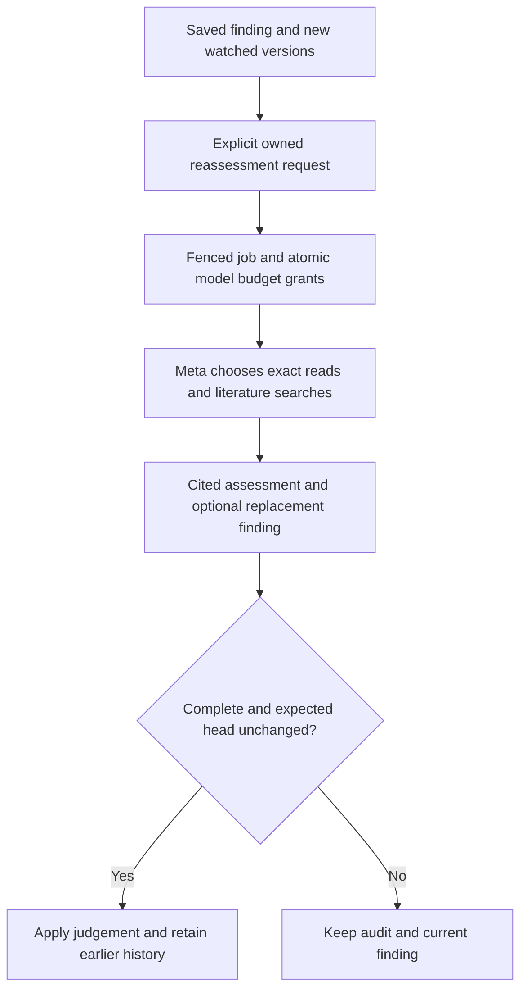

# Reassessment and finding history

Polymath can compare newly collected sources with an exact earlier finding. Meta chooses which sources to read, searches for objections and prior work, and returns a cited judgement. The application checks provenance, spending, current versions and concurrency. The judgement remains a model assessment of the checked evidence.

## Flow

The request pins the finding ID/content hash, root, expected head revision, watch, and one to five exact new source versions/retrievals. A source already quoted or consumed by an applied assessment cannot be submitted as new evidence again for that root. Inconclusive attempts and losing concurrent assessments leave their inputs pending.

## Evidence and intelligence

Historical and new versions use retrieval UUIDs as assessment citation handles. An old abstract and its revision retain their actual paper identity. Fresh literature reads require prior discovery; the worker assigns durable version/retrieval IDs before showing their text. All source text and saved hypotheses are untrusted data.

A completed unchanged, revised or unsupported judgement must read and cite every selected new version and at least one exact original premise. Each substantive rationale paragraph needs an exact citation. Inconclusive judgements can explain missing evidence without fabricating a quotation. Stored quotations retain their content hash, kind and Unicode offsets. Integrity checks do not independently verify the scientific interpretation.

A replacement also satisfies the normal bridge or answer contract, including actual counterevidence/prior-work search receipts. It chooses one current snapshot per known paper alias group. Alias checks use every durably read version, including uncited connectors. Ask preserves its question and inherited claim uncertainty; Surprise preserves its selected fields. Previous findings remain hypotheses rather than primary evidence.

The default controller has twelve model calls/actions, two bounded schema repairs, 4,096 output tokens, 90,000 context characters and at most 200 observed retrievals. Calls share the existing atomic budget/reservation/one-use dispatch journal. Browser-bound jobs require a live browser at each new grant, including after account/job lock waits. Setup and credentials alone cannot authorize paid execution.

## Current version and atomic application

`FindingHead` separates the assessment revision from the current positive result:

| Judgement | Applied effect |
|---|---|
| Unchanged | Advance assessment history and retain the current result and support state |
| Revised | Install a positive candidate that passes the bridge/answer integrity contract |
| Unsupported | Retain the earlier result in history and mark the head unsupported |
| Inconclusive, failed, bounded or concurrent loser | Keep the current head and pending inputs; retain the attempt's audit |

An unchanged judgement cannot restore an unsupported claim. Restoration requires a replacement that passes the same evidence contract. Candidates are saved before application and remain unavailable as current findings until an immutable applied assessment proves their membership. Head changes, the assessment artifact and terminal job outcome commit together under Head → Run locks. A crash cannot leave an applied head paired with an unfinished job.

Default knowledge, model memory, selected parents, new writing and new watch anchors use current supported findings. Cached memory searches are invalidated when that eligible set changes. Explicit owned history, old citations and exact document exports remain readable. Collected sources show whether they are pending, already cited or reviewed for the particular anchored finding; this status does not classify the paper globally.

## Publication and recovery

New preparation/approval/queue/resume/send grants require a current supported source finding. Send authority locks Operator → Manifest → Head → Publication Job and rechecks after waits. Assessment application never locks publisher rows. Readback, late response accounting and reconciliation acquire no scientific-head authority lock; an already verified publication remains a real historical fact after its source finding changes.

Replay protocol `polymath-worker-assessments-v7` binds the task, exact assessment basis, execution policy and limits. Paid responses replay from their existing journal. A lost source read/cache response interrupts explicitly and retries the free immutable read safely on resume. Unknown model outcomes retain their conservative hold and require reconciliation. A committed assessment with a lost worker response remains terminal and is discovered through owned status/history, without another model dispatch.

## API and current limits

The `/api/v1/assessments` API provides capabilities, owned jobs, heads/history, immutable assessment details and an exact positive finding-version reader. Submission requires the browser's CSRF/origin checks and the shared queue limits; HTTP does not construct a model. The finding reader permits applied historical revisions with a warning and rejects unapplied candidates as findings.

Live Meta execution remains disabled under the owner's instruction to continue without paid calls. Automated and browser checks use explicit synthetic model/source fixtures. Native Meta/source compatibility, scientific quality, public/shared ownership and deployment remain separate validation gates. Collection never automatically starts a paid reassessment.
